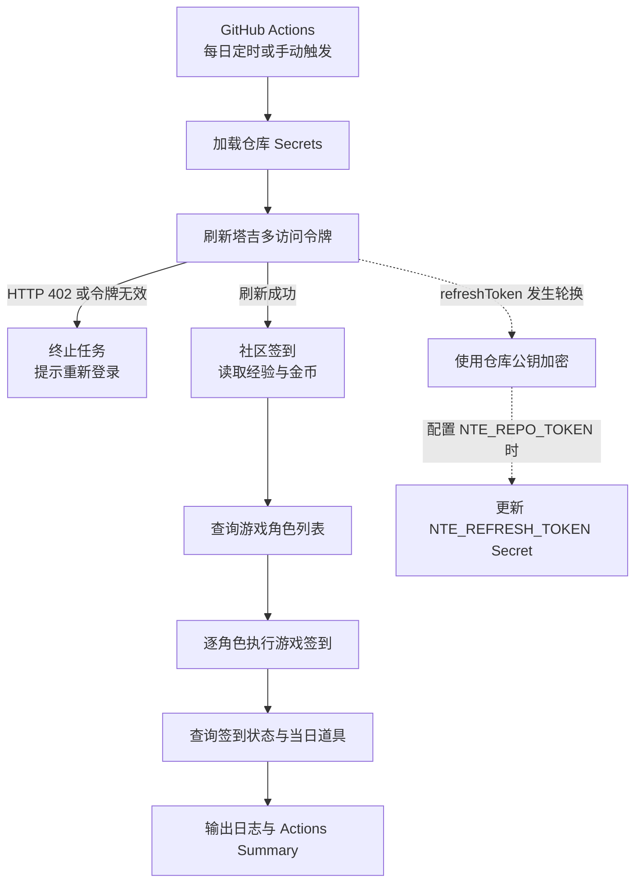
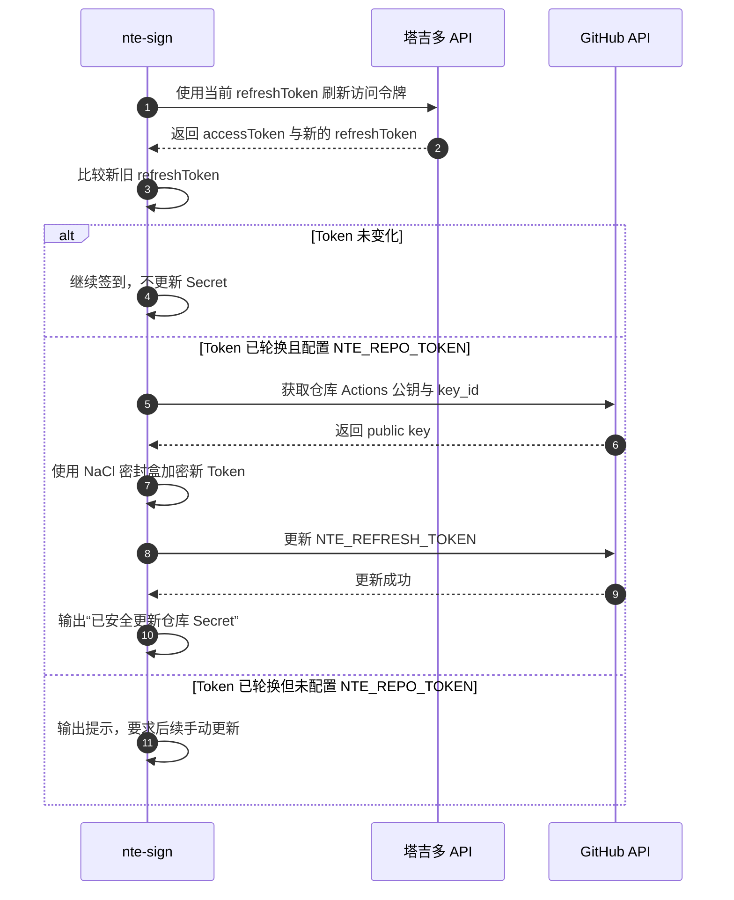

# 异环每日签到（NTE Sign）

[](https://github.com/JimouChen/fk-sign-nte/actions/workflows/daily-sign.yml)
[](go.mod)

一个面向**单账号**的异环·塔吉多自动签到工具。使用 Go 实现，支持本地运行和 GitHub Actions 每日自动执行，并在签到完成后输出社区奖励与游戏道具说明。

项目只保留登录、签到、奖励查询和令牌维护能力，不依赖 AstrBot，也不包含多账号管理或云游戏时长领取。

## 功能特性

- **社区签到**：返回本次获得的经验和金币。
- **游戏签到**：自动查询账号绑定的角色并逐个签到。
- **奖励说明**：根据当日连续签到天数查询并展示对应道具。
- **重复签到识别**：今日已签到视为成功，不重复领取，也不把历史奖励当作新增奖励。
- **令牌自动轮换**：检测新的 `refreshToken`，并可加密回写 GitHub 仓库 Secret。
- **Actions 摘要**：同时输出到运行日志和 GitHub Actions Step Summary。
- **敏感信息保护**：不打印真实 Token，账号 UID 由 GitHub 自动脱敏，不在仓库保存本地凭据。

## 整体工作流程



工作流每次执行都会先运行测试，再构建并启动签到程序；同一工作流通过 `concurrency` 避免并发重复执行。

## 快速开始

### 1. 环境要求

- Go **1.25 或更新版本**
- 可接收短信的塔吉多账号
- 如需每日自动签到：一个 GitHub 仓库，并启用 GitHub Actions

检查本地 Go 环境：

```bash
go version
```

### 2. 获取登录凭据

在项目根目录执行本地短信登录命令：

```bash
go run ./cmd/nte-login
```

按终端提示输入手机号和短信验证码。登录成功后会输出：

```text
NTE_REFRESH_TOKEN=...
NTE_UID=...
NTE_DEVICE_ID=...
```

这些值只显示在本机终端，不会写入项目文件。请妥善保存，不要发送到聊天、提交到 Git 或写入 README。

> **手机重新登录后需要更新凭据**
>
> 如果随后在手机上使用手机号和验证码重新登录塔吉多，旧的 `refreshToken` 可能失效。此时需要重新执行上述命令，并同时更新 `NTE_REFRESH_TOKEN` 和 `NTE_DEVICE_ID`。`NTE_REPO_TOKEN` 只能回写签到接口轮换的 Token，无法同步手机登录产生的新 Token。

### 3. 本地执行签到

将上一步获得的值注入环境变量：

```bash
export NTE_REFRESH_TOKEN='你的 refreshToken'
export NTE_UID='你的 UID'
export NTE_DEVICE_ID='你的 deviceId'

go run ./cmd/nte-sign
```

首次签到成功的输出示例：

```text
异环签到结果
账号 UID：123456789
社区签到成功｜奖励：5 经验、40 金币
角色 Boss(218050184019)签到成功｜今日道具：环石×20
```

当日重复执行时：

```text
异环签到结果
账号 UID：123456789
社区今日已签到｜奖励：无新增奖励
角色 Boss(218050184019)今日已签到｜今日道具：环石×20
```

第二次输出中的“环石×20”是**今日奖励记录**，不是重复发放的奖励。

## 配置 GitHub Actions

### 1. 推送工作流

确保仓库包含 [.github/workflows/daily-sign.yml](.github/workflows/daily-sign.yml)，并将项目推送到 GitHub。

工作流提供两种触发方式：

| 触发方式 | 说明 |
| --- | --- |
| `schedule` | 每天 UTC 16:17，即北京时间次日 00:17 |
| `workflow_dispatch` | 在 Actions 页面手动运行，适合首次验证和故障恢复 |

GitHub 的定时任务可能因平台排队而延迟，实际开始时间不一定严格等于 cron 时间。

### 2. 添加仓库 Secrets

进入：

**Repository → Settings → Secrets and variables → Actions → Secrets → New repository secret**

按下表添加配置：

| Secret | 必要性 | 说明 |
| --- | --- | --- |
| `NTE_REFRESH_TOKEN` | **必填** | 本地短信登录后获得的 `refreshToken` |
| `NTE_UID` | 建议配置 | 用户 UID；刷新接口未返回 UID 时必须配置 |
| `NTE_DEVICE_ID` | 建议配置 | 与登录凭据对应的固定设备 ID；未配置时每次运行会随机生成 |
| `NTE_GAME_ID` | 可选 | 游戏 ID，默认 `1289` |
| `NTE_ROLE_ID` | 可选 | 角色列表不可用或为空时使用的备用角色 ID |
| `NTE_REPO_TOKEN` | 强烈建议 | 允许程序自动回写轮换后的 `NTE_REFRESH_TOKEN` |

> 所有值都应添加到 **Secrets**，不要放入 Variables。`NTE_REFRESH_TOKEN` 和 `NTE_REPO_TOKEN` 尤其需要保密。

### 3. 配置 Token 自动回写

签到前刷新令牌时，塔吉多接口可能返回新的 `refreshToken`。如果仓库 Secret 没有同步更新，下一次任务仍可能使用旧 Token，最终出现 HTTP 402。

为避免手动维护，可创建一个 **fine-grained personal access token**：

1. 打开 [GitHub Fine-grained tokens](https://github.com/settings/personal-access-tokens)。
2. 点击 **Generate new token**，设置名称和有效期。
3. 在 **Repository access** 中选择 **Only select repositories**，仅勾选当前签到仓库。
4. 在 **Repository permissions → Add permissions** 中添加 **Secret**（部分文档称 **Secrets**）。
5. 将权限设置为 **Read and write**，无需添加 `Actions`、`Contents` 或其他权限。
6. 生成 Token，并将 `github_pat_...` 保存为仓库 Secret：`NTE_REPO_TOKEN`。

配置后的轮换流程：



回写成功时，日志会显示：

```text
已安全更新仓库 Secret NTE_REFRESH_TOKEN。
```

未配置 `NTE_REPO_TOKEN` 时签到仍可执行，但发生 Token 轮换后需要手动更新 Secret。PAT 到期后也需要重新生成并替换。

### 4. 首次运行与结果确认

1. 打开仓库 **Actions → 每日签到**。
2. 点击 **Run workflow**，选择 `main` 分支。
3. 等待“运行测试”“构建签到程序”“执行签到”全部完成。
4. 在任务日志或运行页面的 **Summary** 中查看签到结果。

成功的 Summary 示例：

> **异环每日签到**<br>
> 账号 UID：***<br>
> 社区签到成功｜奖励：5 经验、40 金币<br>
> 角色 Boss(218050184019)签到成功｜今日道具：环石×20

只要任务最终状态为成功，且社区和角色结果均为“签到成功”或“今日已签到”，即表示本次流程正常。

## 签到实现逻辑

### 1. 身份认证

程序使用 `refreshToken + deviceId` 请求刷新接口，获取 `accessToken`、最新的 `refreshToken` 和 UID。刷新接口返回 HTTP 402 时，任务会明确提示重新登录，而不是继续执行后续请求。

### 2. 请求签名

每次调用塔吉多接口前，客户端都会根据时间戳、随机字符串、客户端版本和盐生成 DS 请求头，统一携带应用版本与平台信息，并按接口要求附加 UID、设备 ID 和相应令牌。

### 3. 社区签到

提交社区签到请求后，从响应中读取 `exp` 和 `goldCoin`。如果接口提示今日已签到，则将其视为成功状态，奖励显示为“无新增奖励”。

### 4. 角色发现与游戏签到

程序自动获取当前账号在指定游戏下的角色列表，去重后逐个签到。角色列表不可用或为空时，可以使用 `NTE_ROLE_ID` 作为备用角色。

游戏接口提示已签到时，程序会再次查询签到状态进行确认，避免将错误响应误判为成功。

### 5. 当日奖励计算

签到后查询 `todaySign` 和连续签到天数 `days`，再从奖励列表中选取 `days - 1` 对应的奖励项，格式化为“道具名×数量”。

签到成功但奖励查询失败时，结果会单独显示“奖励说明获取失败”，不会把查询失败误写成签到失败。

### 6. 结果汇总与退出状态

- 每个社区和角色分别生成一条结果。
- 同时写入标准输出和 `GITHUB_STEP_SUMMARY`。
- 任一步骤失败时返回非零退出码，让 Actions 正确标记失败。
- 即使签到已完成，Token 回写失败也会使任务失败，以便及时发现下一次任务可能使用的旧凭据。

## 项目结构

```text
.
├── .github/workflows/
│   └── daily-sign.yml          # 定时与手动触发工作流
├── cmd/
│   ├── nte-login/              # 本地短信登录，获取初始凭据
│   └── nte-sign/               # 单账号签到入口与结果汇总
├── internal/
│   ├── ghsecret/               # GitHub Secret 公钥加密与更新
│   └── nte/                    # 认证、签名、角色、签到和奖励协议
├── go.mod
└── go.sum
```

## 安全说明

- 不要把真实 Token、短信验证码或 PAT 写入代码、Issue、日志或聊天记录。
- `NTE_REPO_TOKEN` 只授权当前仓库，只保留 `Secret: Read and write`。
- 新 Token 通过 GitHub 仓库公钥和 NaCl 密封盒加密后才提交更新。
- 程序不会打印真实 `refreshToken`，也不会输出接口原始响应。
- 本地 `.env`、`TOKEN.txt` 等凭据文件已被 `.gitignore` 排除。
- 如果凭据意外泄露，请立即重新登录或撤销对应 PAT，并替换所有相关 Secrets。

## 常见问题

### Actions 显示“refreshToken 已失效”或 HTTP 402

说明仓库中的签到 Token 已失效。重新执行：

```bash
go run ./cmd/nte-login
```

然后同时更新 `NTE_REFRESH_TOKEN` 和 `NTE_DEVICE_ID`，再手动运行工作流。若日志显示 Secret 回写失败，请检查 `NTE_REPO_TOKEN` 是否过期，以及是否具备当前仓库的 `Secret: Read and write` 权限。

### 为什么手动执行成功，下一次定时任务却失败？

常见原因是上一次运行时 `refreshToken` 已轮换，但仓库 Secret 未同步更新。配置 `NTE_REPO_TOKEN`，并确认日志出现“已安全更新仓库 Secret”即可自动维护后续使用的 Token。

### 为什么定时任务没有准点执行？

GitHub Actions 的 schedule 采用 UTC，并可能受到平台调度排队影响。当前配置为每天 UTC 16:17，对应北京时间次日 00:17；延迟执行不代表工作流配置失效。

### 再次手动运行会重复领取奖励吗？

不会。程序会识别“今日已签到”，社区显示无新增奖励，游戏只展示今日对应的道具记录。

### 手机登录后为什么需要重新配置？

手机验证码登录可能使旧 Token 失效，且新 Token 不会自动同步到 GitHub。需要重新运行本地登录命令并更新 Secrets。

## 开发与验证

```bash
# 运行全部测试
go test ./...

# 静态检查
go vet ./...

# 构建签到程序
go build -trimpath -o bin/nte-sign ./cmd/nte-sign

# 构建本地登录程序
go build -trimpath -o bin/nte-login ./cmd/nte-login
```

## 致谢与说明

核心协议逻辑参考 [Candy-QAQ/astrbot_plugin_nte](https://github.com/Candy-QAQ/astrbot_plugin_nte)，在此基础上移除了 AstrBot、多账号管理及云异环时长领取，仅保留独立的短信登录和单账号每日签到链路。

本项目仅用于个人账号的日常自动化，与塔吉多或异环官方无关。第三方接口可能发生调整，如遇协议变化请提交 Issue 或更新实现。
